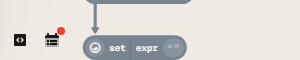
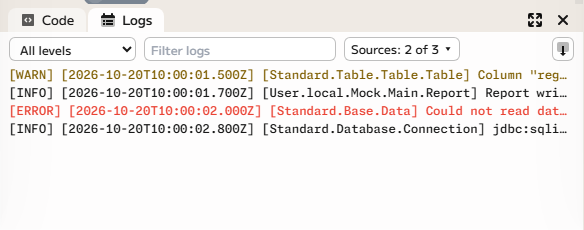
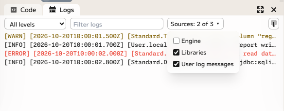

# Engine logs

The _engine_ is the part of Enso that runs your graph. While it works it writes
a log: messages about what it is doing, warnings about data it could not handle,
and errors when something goes wrong. When a result is not what you expected, or
a project will not run, the log usually says why.

## Open the logs

The logs are in the bottom panel of the editor. While that panel is closed, two
small buttons sit at the bottom of the left edge of the graph: **Code**, which
shows the project's code, and **Logs**.

Click **Logs**, or press <kbd>Ctrl</kbd>+<kbd>L</kbd> (<kbd>⌘</kbd>+<kbd>L</kbd>
on macOS) while a project is open. The same shortcut switches the panel to the
logs if it is showing the code, and closes it again when the logs are showing.

A red dot on the **Logs** button means the engine has logged new errors since
you last looked.

## The panel

The panel has two tabs, **Code** and **Logs**, on its left. At its right are a
button to make it fill the window (and back again) and a button to close it.
<kbd>Ctrl</kbd>+<kbd>`</kbd> (<kbd>⌘</kbd>+<kbd>`</kbd>) does for the code what
<kbd>Ctrl</kbd>+<kbd>L</kbd> does for the logs.

The log is live: new lines appear at the bottom as the engine writes them, and
the view stays at the newest line. If you scroll up to read, it stops following
the log, and a **Jump to latest** button takes you back to the bottom.

## Reading and filtering

Every line starts with its level in square brackets, then the time, then who
logged it: `[ERROR] [2026-10-20T10:00:02.000Z] [Standard.Base.Data] …`. Errors
are shown in red and warnings in amber.

Three controls at the top narrow the log down:

- **Level** shows **All levels**, **Warn and above**, or only **Error**.
- **Filter logs** shows only the lines that contain the text you type.
- **Sources** says whose messages to show:

  

  - **Engine**: the engine's own internal messages. They are off to begin with.
  - **Libraries**: messages from the standard libraries, such as a warning from
    the table library.
  - **User log messages**: messages written by your own workflow's logging.

  Libraries and User log messages are on to begin with. The button shows how
  many of the sources are ticked, for example **Sources: 2 of 3**.

Two more sources can be added in Settings (the cog at the bottom of the left
edge, then **Settings**, then **Local**), under **Engine logs**:

- **Log SQL queries** writes each SQL query that a database connection runs to
  the log, and adds **SQL queries** to the sources. Common ways of putting a
  password in the connection address are hidden, and the values of a query's
  parameters are not logged, but SQL you write yourself is logged as you wrote
  it: look through the log before you share it.
- **Log performance timings** writes how long each tracked operation took,
  database queries among them, and adds **Performance** to the sources.

These two settings take effect the next time a project's engine starts, so close
and reopen an open project to apply them.

If the log is long, only the latest lines are kept in view; **Load older lines**
reads earlier ones from the log's file. A **Back to live** button returns to the
latest.

## Earlier sessions

Each time a project's engine starts, it begins a new _session_ with a log of its
own. To read the log of an earlier session, open the **Activity** tab on the
right edge of the window, which lists the project's sessions, and choose **Show
Logs** on one. It opens in a tab of its own, with the same level, filter and
source controls and a **Session** list to move between sessions.

## Send logs with a bug report

When you report a problem at
[github.com/jdunkerley/enso/issues](https://github.com/jdunkerley/enso/issues),
the log helps us see what happened. The two buttons at the right of the Logs
toolbar help with that:

- **Download log file** saves the session's log file you can attach to your
  report.
- **Reveal in Explorer** (**Show in Finder** on macOS, **Show in folder** on
  Linux) opens the folder that holds the log file, in the desktop app.

Look through the log before you share it. It can contain names of files and
projects, the text of messages from your own workflows, and, if you turned on
**Log SQL queries**, the SQL you wrote.
