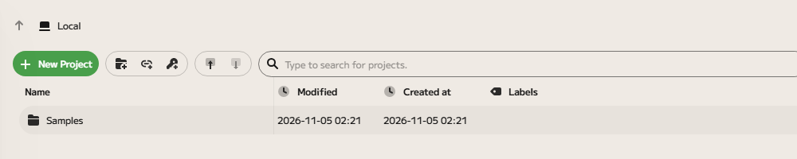
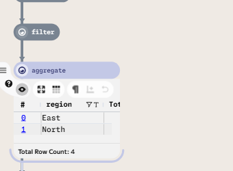

# Getting started

An Enso project is a graph: each box (a _node_) is one step, such as reading a
file, filtering a table or summing a column, and the lines between nodes carry
the result of one step into the next. This page walks through making a first
graph. Everything stays on your computer: Enso needs no account.

## Create a project

When Enso starts it shows your projects in the _drive_. The buttons down the
left edge switch between **Local** (your projects folder), **Recent** (the
projects you opened lately) and saved folders you added with **Add Folder**.

Choose **New Project**. Enso creates a project called "New Project 1" (or the
next free number) and opens it in the editor beside the drive. To open a project
that is already there, click the ▶ button at the start of its row.

Projects are folders. By default they are kept in an `enso-projects` folder
inside your Documents folder. To keep them somewhere else, change the **Root
Folder** in Settings (the cog at the bottom of the left edge, then **Settings**,
then **Local**).

## Add a component

Components are the building blocks: reading data, filtering, joining, charting
and so on. To add one, click an empty part of the graph and press
<kbd>Enter</kbd>. The component browser opens.

<!-- TODO screenshot: the component browser, with a few characters typed and the matching
     components listed (needs a running engine for its component list). -->

Start typing what you want to do. The browser lists the components that match
what you typed, and it also matches their alternative names, so searching for
"sum" or "group" finds the components that do those things. Use the arrow keys
to move down the list and press <kbd>Enter</kbd> to add the highlighted
component. <kbd>Shift</kbd>+<kbd>Enter</kbd> puts it in the text box instead, so
you can edit it before adding it. Press <kbd>Esc</kbd> to close the browser
without adding anything.

If a node is selected when you press <kbd>Enter</kbd>, the new component takes
that node's result as its input, so you build a chain by selecting the last node
and adding the next.

## Connect components

You can also connect nodes yourself. Drag from the output port at the edge of a
node and drop the line on another node to make it an input of that node. Drop it
on an empty part of the graph and the component browser opens with the dragged
result already connected. To remove a connection, select the line and press
<kbd>Delete</kbd>.

## Read a result

Select a node and press <kbd>Space</kbd>, or use the eye button in the toolbar
that appears under it, to show its result under the node. A table appears as a
table. The toolbar also has a button to choose another visualization, such as a
chart, that suits the data.

Press <kbd>Space</kbd> again to hide the result. Results are worked out by the
engine as you edit, so they follow your changes.

## Get help on a component

Every component has documentation: what it does, what each argument means, and
examples. There are three ways to see it:

- in the component browser, the help beside the list shows the highlighted
  component's documentation;
- click the **?** button beside a selected node to open that component's
  documentation in the **Help** tab on the right of the editor;
- read it here, in the [Components](../api/index.md) reference, which has the
  same text for every component of the standard libraries.

<!-- TODO screenshot: the Help tab with a component's documentation open (needs a running
     engine for the component documentation). -->

## Save and close

Enso saves your graph as you edit it. If you have
[versions turned on](../local-versioning/index.md), press
<kbd>Ctrl</kbd>+<kbd>S</kbd> (<kbd>⌘</kbd>+<kbd>S</kbd> on macOS) to keep a
named snapshot you can return to later. Close a project with the ✕ on its tab;
closing also saves a version when versions are on.

## Next steps

- Open a [sample project](../samples/index.md) to see finished graphs.
- Learn how to [keep versions of your projects](../local-versioning/index.md).
- Browse the [Components](../api/index.md) reference.
