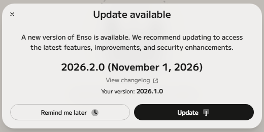
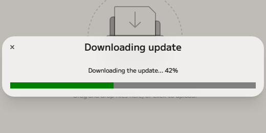
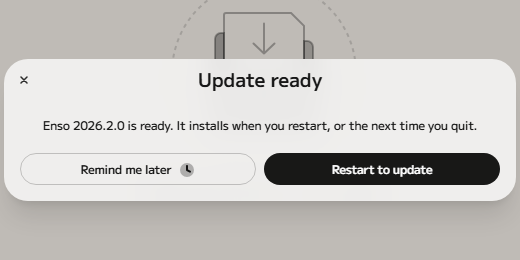
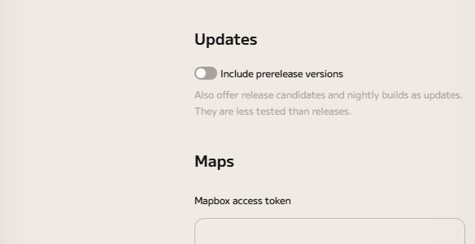

# Installing and updating

## Download

Installers are on the project's
[releases page](https://github.com/jdunkerley/enso/releases). Download the file
for your computer:

| Computer              | File                                   |
| --------------------- | -------------------------------------- |
| Windows               | `enso-win-x64-<version>.exe`           |
| macOS (Apple silicon) | `enso-mac-arm64-<version>.dmg`         |
| Linux                 | `enso-linux-x86_64-<version>.AppImage` |

Stable releases are marked **Latest**. Release candidates and nightly builds are
marked **Pre-release**: they have the newest changes but are less tested, so
choose a stable release unless you want to try what is coming. Each installer
has a `.sha256` file beside it, if you want to check the download.

The installers are not signed, so your computer will warn you the first time you
run one. The sections below say how to get past the warning.

## Install on Windows

Run the `.exe`. It does not ask any questions: it installs Enso for your user
account only, so it needs no administrator rights, puts it in
`%LOCALAPPDATA%\Programs\Enso`, adds Start Menu and desktop shortcuts, and
starts Enso when it finishes.

Because the installer is not signed, Windows may show a blue **Windows protected
your PC** (SmartScreen) window. Choose **More info**, then **Run anyway**.

Your projects are not kept in the install folder: by default they go in an
`enso-projects` folder inside your Documents folder (see
[Getting started](../getting-started/index.md)).

## Install on macOS

Open the `.dmg` and drag **Enso** into your **Applications** folder. Enso needs
macOS 12 or later, on a Mac with Apple silicon.

The app is not signed or notarized, so the first time you open it macOS will
refuse. Control-click (or right-click) the app, choose **Open**, then **Open**
again. If that does not offer the choice, open **System Settings**, go to
**Privacy & Security**, and choose **Open Anyway** next to the message about
Enso.

## Install on Linux

Enso for Linux is an AppImage: a single file that runs without being installed.
Make it executable, then run it:

```bash
chmod +x enso-linux-x86_64-<version>.AppImage
./enso-linux-x86_64-<version>.AppImage
```

Your file manager can do the same: open the file's properties and allow it to be
run as a program. Keep the file where you will find it again, because that file
is the application.

## Updates

Enso checks for a new version when it starts, and then once a day. When there is
one, a dialog tells you the new version and the date it was published, with a
link to what changed. Nothing is downloaded until you ask.



Choose **Update** and Enso downloads the new version in the background; the
dialog shows the progress and you can keep working.



When the download is finished, choose **Restart to update**. Enso restarts and
installs the new version. Restarting does not save a version of your open
projects, so save any you want to keep first (see
[versions](../local-versioning/index.md)). If you would rather wait, choose
**Remind me later**: the update is installed the next time you quit Enso.



If the download fails, the dialog says so and offers **Retry** and **Download
manually**, which opens the release's page so you can download the installer
yourself.

### When Enso cannot update itself

Windows installs and the Linux AppImage update themselves as described above.
Two kinds of build cannot: the macOS app, because it is not signed, and
development builds. In those, the dialog has a **Download** button instead of
**Update**: it downloads the installer for the new version, and you run it as
you did the first time (on macOS, drag the new app over the old one).

### Prerelease versions

By default Enso offers you stable releases only. To be offered release
candidates and nightly builds too, open Settings (the cog at the bottom of the
left edge, then **Settings**, then **Local**) and turn on **Include prerelease
versions** under **Updates**. Turning it on checks for a newer one straight
away.



This setting only appears in the desktop app.

## Uninstalling

- **Windows:** open **Settings**, then **Apps**, find **Enso** and choose
  **Uninstall**.
- **macOS:** drag **Enso** from your Applications folder to the Trash.
- **Linux:** delete the AppImage file.

Your projects are kept: they are in your Documents folder, not with the
application. Enso's settings and your [secrets](../secrets/index.md) also stay
on your computer, so installing Enso again finds them. If you want your projects
gone too, delete the `enso-projects` folder in your Documents folder yourself.
