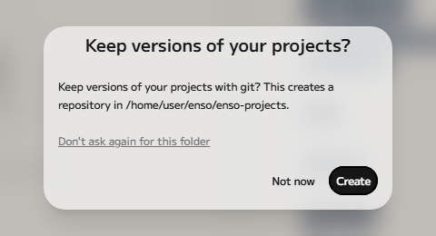
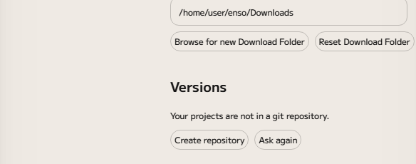
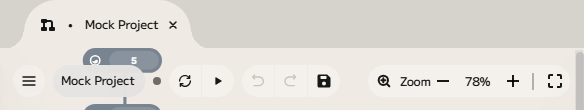
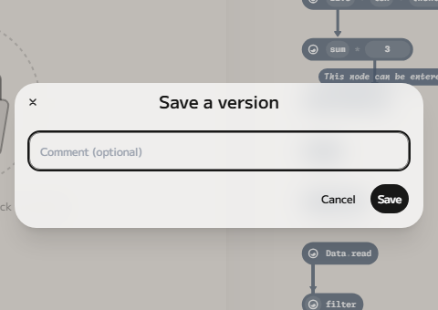
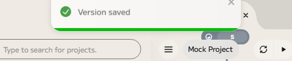
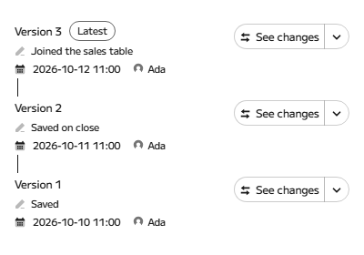
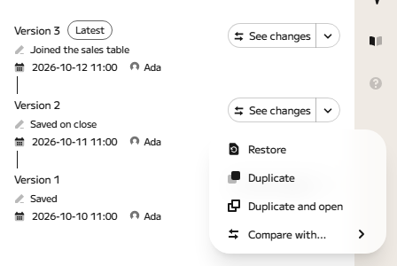
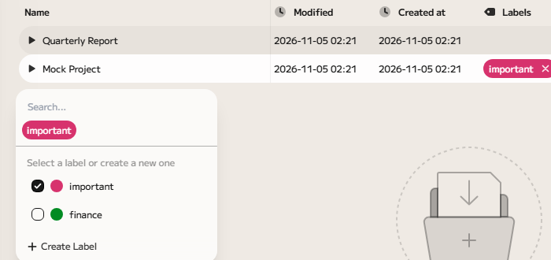
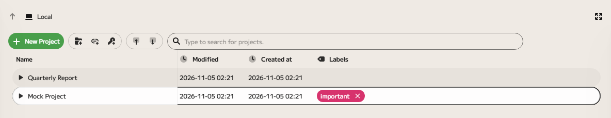
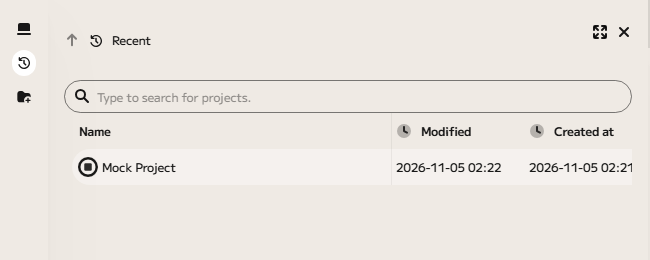

# Versions of your projects

Enso can keep a history of each of your projects. A _version_ is a saved
snapshot of a project, kept on your computer. You can look at what changed
between versions, go back to an earlier one, or start a new project from it.

This page also covers [labels](#labels) and the [Recent list](#recent), which
help you find projects.

## What a version is

A version holds everything in the project's folder, except Enso's own working
files (the `.enso` folder, which holds caches) and backup files ending in
`.bak`. Versions are kept with [Git](https://git-scm.com/), a free tool that
records history, and Enso uses the copy of Git installed on your computer. You
do not need to know how to use Git: Enso does the work.

If Git is not installed, Enso says so in Settings (**Git was not found**) and in
the Versions tab, and it hides the save button. Install Git, and versions work
straight away; there is no need to restart Enso.

## Turn versions on

The first time you save or close a project in a folder that is not in a Git
repository, Enso asks:

- **Create** makes a Git repository in your projects folder and keeps versions
  of every project in it.
- **Not now** skips it; Enso asks again the next time you start.
- **Don't ask again for this folder** stops the question for good.

If your projects folder is already inside a Git repository that you made
yourself, Enso uses it without asking when the repository starts in the projects
folder or inside it. For any other repository, such as one that covers your
whole home folder, Enso asks first ("Keep versions of your projects in the
existing repository at …?") and never writes to one you did not agree to.

You can change your mind in Settings (the cog at the bottom of the left edge,
then **Settings**, then **Local**), under **Versions**:

- **Create repository** or **Use this repository** turns versions on.
- **Stop keeping versions** turns them off. Your earlier versions stay in the
  repository, and you can turn versions back on later.
- **Ask again** brings back the question for the folders and repositories you
  chose "Don't ask again" for.

Versions are kept only for projects in your projects folder (and for projects
elsewhere that already sit inside a repository). For a project outside both,
Enso explains that no versions are kept for it.

## When versions are saved

Enso saves a version:

- when you **close a project** (the version is called "Saved on close");
- when you **save by hand**, as described next.

Enso does not save a version when you quit the application: close a project
first if you want its version saved. (Your graph itself is always saved
automatically as you edit; versions are the snapshots you can return to.)

### Save by hand

Press <kbd>Ctrl</kbd>+<kbd>S</kbd> (<kbd>⌘</kbd>+<kbd>S</kbd> on macOS) to save
a version straight away, called "Saved". Press
<kbd>Ctrl</kbd>+<kbd>Shift</kbd>+<kbd>S</kbd>
(<kbd>⌘</kbd>+<kbd>Shift</kbd>+<kbd>S</kbd>), or click the save button in the
top bar, to give the version a comment first.

The shortcuts work anywhere in an open project, including while you are typing
in the code editor or the documentation. They do not act while the component
browser or the command palette has the keyboard, or while you are working in the
drive panel on the left of the window.

A small dot beside the project's name in the top bar, and a ● on its tab, show
that the project has changed since its last version. The save button is dimmed
when there is nothing to save.

While Enso saves, a message says **Saving a version…**, and **Version saved**
appears when it is done.

If you press the shortcut and nothing is saved, Enso tells you why, so you are
never left guessing:

- **Nothing has changed since the last version.**
- **Versions are not ready yet**: Enso is still reading the project's status;
  try again in a moment.
- **Versions are off for this folder**: turn them on in Settings, as above.
- **Versions cannot be saved**, followed by Git's reason: for example, the
  repository is in the middle of something else, such as a merge.

If you save again while a save is still running, nothing is lost. A comment you
type is added to the save in progress; if that save has already been committed,
your comment is saved in a second version straight after, with any edits made in
between.

## The Versions tab

To see a project's versions, select it in the drive (or open it) and choose the
**Versions** tab on the right edge of the window.

Versions are listed newest first, each with its comment, the date and who made
it. The newest is marked **Latest**. A version made when you closed the project
is "Saved on close"; one you saved by hand is "Saved", or has the comment you
gave.

- **See changes** shows what changed in the project's `Main.enso` file since the
  version before.
- Click a comment's pencil icon to change it. You can add or change a comment on
  any version at any time.

## Restore and duplicate

Each version has a menu (the arrow beside **See changes**):

- **Restore** turns the project back into how it was at that version. If the
  project is open, Enso closes it first, saving a "Saved on close" version, so
  nothing is lost; any other unsaved changes are saved as "Saved before
  restore", and the restore itself is recorded as a new version called "Restored
  version from" and its date. You can always go forward again.
- **Duplicate** makes a new project from that version and leaves the original
  alone. **Duplicate and open** does the same and opens the new project.
- **Compare with…** shows the changes between two versions you choose.

## Labels

Labels are coloured tags you put on projects, to group them (for example
"finance" or "to review").

To label a project, right-click it in the drive and choose **Label**, then pick
a label from the list. Choose **Create Label** to make a new one: give it a name
and a colour.

A label shows beside the project in the **Labels** column, and clicking the ✕ on
it removes it.

To find projects by label, click the search box above the list: the labels
appear under it as buttons, and clicking one shows only the projects with that
label.

Labels belong to projects, not to folders. A project's labels are kept in the
project itself, so they stay with it when you copy it and are included in its
versions.

## Recent

**Recent**, the clock button on the left edge, lists the projects you opened
lately, newest first (up to 20).

Right-click a project and choose **Remove from Recent** to drop it from the
list. That only removes it from the list: the project itself is not touched.
