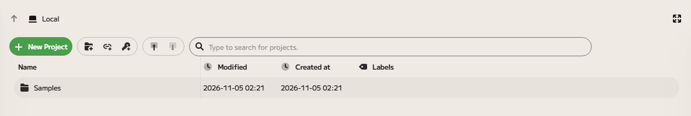
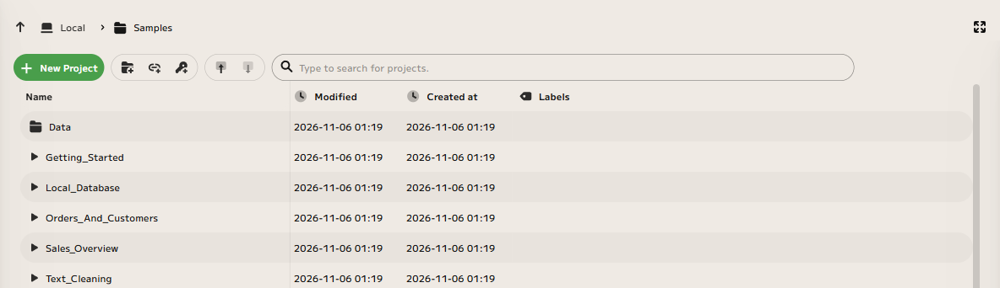

# Sample projects

Enso comes with five small example projects, so you can see finished graphs
before you build your own. They use made-up data and need no setup.

| Sample                 | What it shows                                                                                                                                                                           |
| ---------------------- | --------------------------------------------------------------------------------------------------------------------------------------------------------------------------------------- |
| `Getting_Started`      | A first look at Enso, step by step: reads a file of orders, keeps one category, totals it by month and charts the totals. It opens by itself the first time Enso starts, and only then. |
| `Sales_Overview`       | Reads a messy sales file, removes duplicates and rows with no amount, tidies the region names, and totals sales by month and region.                                                    |
| `Orders_And_Customers` | Joins orders to the customers who placed them, builds a table of spend by segment and category, and writes it to an Excel workbook.                                                     |
| `Local_Database`       | Loads a file of trips into a small database that lives in memory, then summarises it with a query that runs inside the database.                                                        |
| `Text_Cleaning`        | Tidies a contacts table: fixes the spacing and capitals of names, splits them into first and last name, cleans up phone numbers and pulls codes out of notes.                           |

## Where they are

The samples are installed with Enso. The first time Enso starts, it copies them
into a folder called `Samples` inside your projects folder (by default the
`enso-projects` folder in your Documents). Nothing is downloaded.

Enso copies the samples only when there is no `Samples` folder yet. That means
your changes are never overwritten, and a sample you delete stays deleted.

On that first start Enso also opens `Getting_Started`. Its **Documentation** tab
walks you through the graph one node at a time. It opens by itself only once:
after you close it, Enso starts on the drive, and you open the sample from the
`Samples` folder like the others.

## Open a sample

Open the **Local** drive and double-click the `Samples` folder to look inside,
then click the ▶ button at the start of a sample's row to open it. The `Data`
folder beside them holds the samples' input files; it is not a project.

Each sample describes itself: open the **Documentation** tab on the right of the
editor to read what it does and which nodes to look at. Select a node and press
<kbd>Space</kbd> to see its result, as described in
[Getting started](../getting-started/index.md).

Two things to know:

- `Local_Database` previews database changes while you edit and does not run
  them. Press the **Write All** button at the top of the graph (or **Write** on
  the node) to run the upload, then select the `summary` node to see the result.
- `Orders_And_Customers` writes an Excel file, `spend_by_segment.xlsx`, into the
  project's own `output` folder. As with the database upload, this happens when
  you press **Write All** (or **Write** on the node).

## Where their data is

The samples share one folder of input files, `Samples/Data`, beside the sample
projects. Each sample reads its file from there, relative to its own place in
`Samples`, so a sample you copy or move out of the `Samples` folder can no
longer find its data: its read node shows an error. To use a sample elsewhere,
change the path in its file node (the one named like `sales_file`, at the start
of the graph) to where the file is.

## They are ordinary projects

A sample is a normal project: change it, rename it, copy it, or use it as the
start of your own. If you [keep versions](../local-versioning/index.md) of your
projects, the samples are included.

## Get a fresh copy

To get the original samples back, close any open sample, then rename or delete
the `Samples` folder and restart Enso. It installs a new `Samples` folder. If
you only renamed the old one, it stays where it is, so your edits are kept
beside the fresh copies.
