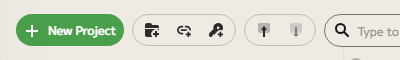
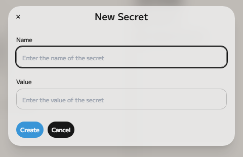
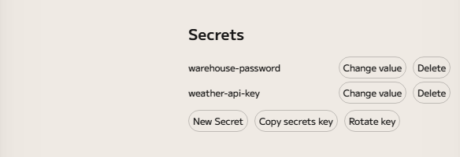

# Secrets

A _secret_ is a named value that you do not want to write into a project: a
database password, an API key, a token. You give it a name once, and your
workflows refer to it by that name. The value itself never appears in your
graph, in your project's files or in its
[versions](../local-versioning/index.md), so you can share and save a project
without sharing the password.

Secrets belong to you, not to a project: every project on your computer sees the
same list.

## Create a secret

There are two places to create one.

**In the drive.** Click the key button in the drive's toolbar, next to the New
Folder and New Datalink buttons.



Enter a name and the value, then choose **Create**.



Enso then shows a message with the secret's address, such as
`secret://warehouse-password`, and a **Copy** button for it. That address is how
code refers to the secret.

**In Settings.** Open Settings (the cog at the bottom of the left edge, then
**Settings**, then **Local**) and find **Secrets**. Choose **New Secret** to get
the same dialog.



The Secrets section, and the New Secret button in the drive, are in the desktop
app only.

## Use a secret in a workflow

Components that need a password or a key, such as the password of a database
connection or a header sent with a web request, take a secret instead of plain
text. On such an argument, open the argument's list: it shows the names of your
secrets, and **New secret…** to make one on the spot. Choosing a name fills the
argument in with that secret.

<!-- TODO screenshot: a component's argument with its list of secrets open (needs a running
     engine for a component with a secret argument). -->

In the code, that looks like this:

```
Enso_Secret.get "warehouse-password"
```

The text `secret://warehouse-password` works the same way wherever a component
accepts a secret.

Enso keeps the value hidden from your workflow too. The component that uses a
secret receives it, but a secret is displayed as `__SECRET__`, cannot be turned
into text, and is never sent over a plain (not encrypted) web connection.

A data link, a small file that describes a connection to some data, can use a
secret in the same way. When you fill in its password or key you can choose
**Secret** instead of **Plain text** and pick one of your secrets.

## Change and remove secrets

In Settings, under **Secrets**:

- **Change value** asks for a new value for a secret. You cannot see the old
  value: Enso never shows a secret's value, only its name.
- **Delete** removes a secret, after asking you to confirm. A workflow that
  still uses it will fail until you create it again.

## Where secrets are kept

Secrets are stored on this computer only, in an encrypted file, `secrets.json`,
in the `.enso` folder of your home folder. Each value is encrypted; the names
are not, so Enso can list them.

The key that unlocks the file is kept in your computer's own store for
passwords: Windows Credential Manager, the macOS Keychain, or the Secret Service
on Linux. Enso creates the key for you.

Two things follow:

- **Anyone who has both the file and the key can read every secret.** That is
  why **Copy secrets key** (in Settings) warns you before it puts the key on
  your clipboard. Copy it only to use your secrets on a server you trust.
- **If you lose the key, the values cannot be recovered.** This can happen if
  the file is moved to another computer without its key, or if the key was
  deleted from the password store. Settings then says that your secrets cannot
  be read and offers **Reset secrets**, which deletes every secret and starts
  again with a new key.

### Rotating the key

**Rotate key** re-encrypts every secret with a new key. Enso reminds you once
the key is over a year old, and reminds you again each month until you rotate
it. Close your open projects first, because a running project holds the old key:
the button is not available while any project is open. If you have copied the
key to a server, that server needs the new key and the new `secrets.json`
afterwards.

### Using secrets on a server

To use your secrets where Enso's desktop app is not installed, such as a server
or a scheduled job, copy `secrets.json` there and set the environment variable
`ENSO_SECRETS_KEY` to the key that **Copy secrets key** gave you. If
`ENSO_SECRETS_KEY` is set on your own computer, Enso uses it instead of the
password store. The wiki's
[Local Secrets](https://github.com/jdunkerley/enso/wiki/Local-Secrets) page has
the details.
